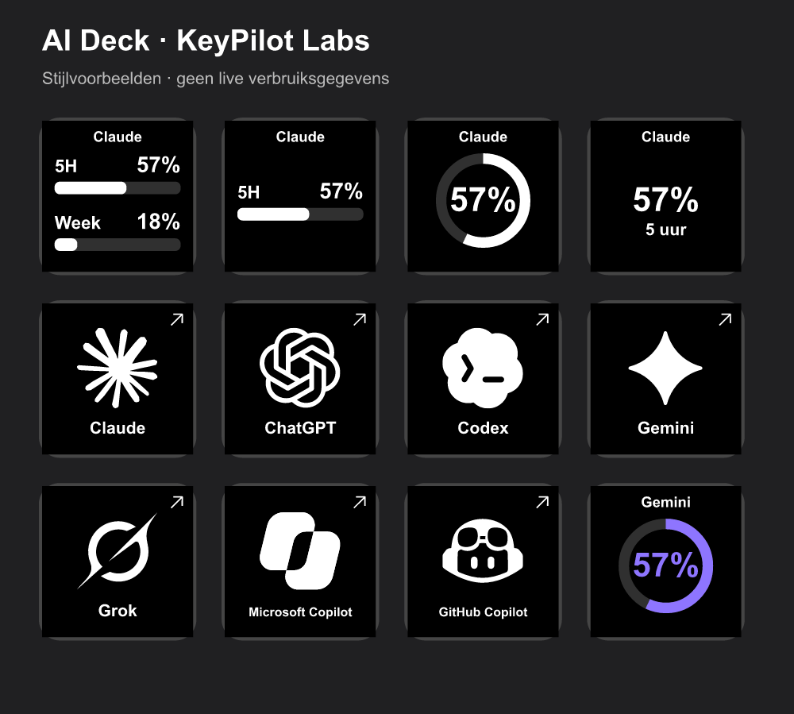

# AI Deck by KeyPilot Labs

A customizable Windows Stream Deck plug-in for Claude, ChatGPT, Codex, Gemini, Grok, Microsoft Copilot and GitHub Copilot.

**0.1 beta — app controls work independently of usage connections. Automatic usage is currently implemented for Claude, Codex and GitHub Copilot only.** This is an independent project, not an official integration from those providers.



## Install

Download `com.keypilotlabs.ai-deck.streamDeckPlugin` from [Releases](https://github.com/robertzijverden/ai-deck/releases), double-click it, and confirm installation in Stream Deck. Requires Windows 10+ and Stream Deck 7.1+.

Drag an action from **AI Deck** onto a key, then choose the AI service. The interface is currently in Dutch.

## Actions

| Action | Behavior |
| --- | --- |
| Verbruik | Usage meter, with automatic refresh for supported connections; manual mode is explicitly labelled |
| Open AI | Finds an installed app through the Windows Start menu, otherwise opens its website |
| Sluit AI | Requests a normal window close for the configured desktop app |
| Open / lang indrukken sluit | Short press opens; holding 650 ms closes on release; duration is configurable |
| Nieuwe chat | Opens the service's conversation start page in the browser |
| Kopieer prompt | Copies a saved prompt; never sends it automatically |
| Verbruikspagina | Opens the provider's usage page where known, otherwise its home page |

Each action has the same service picker. Desktop closing is available for a separate desktop app only, never for shared browser processes. Some services may restore their last session when their start page opens; the plugin does not use undocumented chat-creation shortcuts.

## Appearance

- Black/white, white/black, brand color and custom themes.
- Separate background, text, fill and empty-track colors.
- Optional warning and critical colors with editable thresholds.
- Two bars, one bar, a ring or a large percentage; used or remaining percentage.
- Optional labels, percentages and reset countdowns.
- Existing brand SVG assets from [LobeHub Icons](https://github.com/lobehub/lobe-icons), including monochrome, original color where provided, framed, wordmark and initials variants. No AI-generated app logos.
- Upload your own PNG/JPG icon. It is resized and stored in the key settings.
- Immediate style preview clearly marked as sample data.

## Connecting accounts

For ordinary controls, use **Open app / aanmelden** and sign in in the normal app or browser. No API key is needed.

Automatic usage requires **Verbruik koppelen** to be enabled for that key. This explicitly permits reading the corresponding official CLI's existing local login. The plug-in never asks you to paste passwords or tokens. **Aanmelden voor verbruik** starts the official sign-in flow if its tool is already installed; **Installatiehulp** opens official instructions otherwise. **Verbinding controleren** reports the result.

| Service | Automatic usage in this beta | Login source |
| --- | --- | --- |
| Claude | Experimental 5-hour / weekly meter | Claude Code CLI login |
| Codex | Experimental Codex 5-hour / weekly meter | Codex CLI ChatGPT login |
| GitHub Copilot | Experimental monthly premium interactions | GitHub CLI login |
| ChatGPT chat | Not implemented | Normal app/browser login for controls |
| Gemini chat | Not implemented | Normal app/browser login for controls |
| Grok chat | Not implemented | Normal app/browser login for controls |
| Microsoft Copilot | Not implemented | Normal app/browser login for controls |

A Codex meter is **not** presented as a generic ChatGPT chat allowance. Unsupported services show **Niet beschikbaar**, never a made-up percentage. You can explicitly choose manual mode, marked **HANDMATIG**.

The usage connectors reuse internal endpoints from the upstream project. They can change or stop working. They are not public supported subscription APIs. Display settings share a cache to avoid multiplying requests. Refresh is at least five minutes; pressing a key is throttled and rate-limit backoff is respected. Expired logins require signing in again. No user account was used to validate all live providers in this beta.

## Privacy and support

Read [PRIVACY.md](PRIVACY.md). No KeyPilot backend, analytics or telemetry. Local account secrets are not bundled or uploaded. Prompts and imported images are stored in Stream Deck profiles and may be included in profile exports.

[Report a problem](https://github.com/robertzijverden/ai-deck/issues). Include your Stream Deck version, chosen action and service, and what happened. Do not attach tokens, credential files or private prompts.

## Development

Use Node.js 24 for development/testing (the packaged plugin runs in Stream Deck's Node 20 runtime), and pnpm 11.

```sh
pnpm install --frozen-lockfile
pnpm run build
pnpm run lint:tsc
pnpm test
pnpm run test:integration
pnpm run pack
```

The implementation is in `src/deck/`; the upstream provider and regression-test modules are retained. `scripts/import-logos.mjs` embeds the pinned logo package. `scripts/build-assets.mjs` creates the package icons and preview image. `pnpm run preview` opens a local preview server at http://127.0.0.1:8765 (it uses sample values, not your account).

## Credits and license

Usage connectors, caching and regression tests are derived from [Sing3Rous/stream-deck-ai-limits](https://github.com/Sing3Rous/stream-deck-ai-limits), copyright 2026 David Utyuganov, MIT. The original license is retained. New AI Deck controls and customization are by KeyPilot Labs. Brand SVG assets are from LobeHub Icons, MIT; trademarks remain with their respective owners.

This is a Windows beta for direct testing. Elgato Marketplace approval has not been obtained. macOS support, direct consumer-app usage connections and additional provider-specific actions remain future work.
